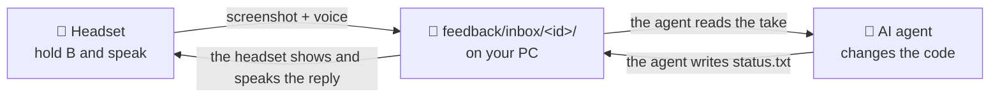
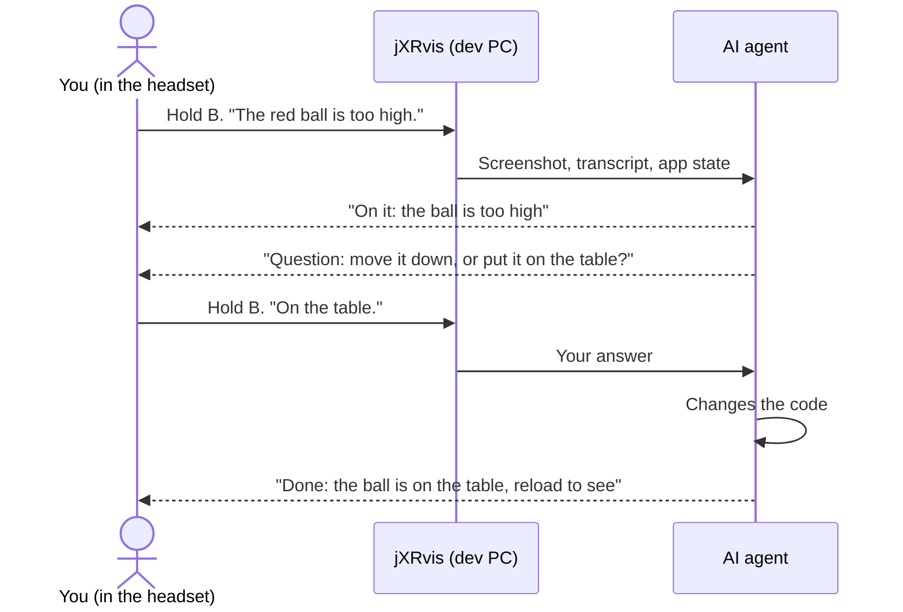

# jXRvis

**Speak to your AI coding agent from inside the headset.**

jXRvis connects a WebXR headset to an AI coding agent (Claude Code, Codex, Cursor or other agents). You test your app in the headset. When you see a problem, you hold the B button and you speak. The agent receives a screenshot, your words and the app state. The agent changes the code. Then the agent replies in your view and in your ear. You do not remove the headset.



All data stays on your PC. jXRvis does not use a cloud service. Git does not record the feedback files.

## A conversation



## The contents of a take

A take is one recording. jXRvis keeps each take in a folder:

```
feedback/inbox/2026-11-07_14-03-22/
├── view.png         your view when you started to speak
├── view-2.png …     more screenshots that you asked for
├── voice.webm       your voice
├── transcript.txt   your words as text (only with the Whisper server)
├── context.json     the app state, the head position, the console errors
└── status.txt       the replies from the agent, one line for each reply
```

## Test the example

1. Clone the repository:

   ```bash
   git clone https://github.com/e-mric/jxrvis.git
   ```

2. Start the example:

   ```bash
   cd jxrvis && npm install && npm run example
   ```

3. Open http://localhost:5173 in your browser.
4. Hold the F key and speak.
5. Release the F key. jXRvis puts the take in `example/feedback/inbox/<id>/`.
6. Write a reply as the agent. Add a line to the `status.txt` file of the take:

   ```bash
   echo "Done: ball moved down, reload to see" >> example/feedback/inbox/<id>/status.txt
   ```

7. Look at the page. The reply shows in 3 seconds or less.

To test on a Quest:

1. Type `npm run example:headset`.
2. On the Quest, open `https://<your-pc-ip>:5173`.
3. Accept the certificate warning. You do this one time only.
4. Push **Enter VR**.
5. Hold the B button and speak.

## Add jXRvis to your project

1. Install the package:

   ```bash
   npm install --save-dev github:e-mric/jxrvis
   ```

2. Add the Vite plugin to `vite.config.ts`:

   ```ts
   import {jxrvis} from 'jxrvis/vite';
   export default defineConfig({plugins: [jxrvis()]});
   ```

3. Attach the headset client to your three.js scene:

   ```ts
   import {attachFeedback} from 'jxrvis/three';

   const feedback = attachFeedback({renderer, scene, camera, agentName: 'Claude'});
   renderer.setAnimationLoop(() => {
     feedback.update(clock.getDelta());
     renderer.render(scene, camera);
   });
   ```

4. Connect your agent:

   ```bash
   claude mcp add jxrvis -- npx jxrvis-mcp --inbox feedback/inbox
   ```

5. Copy [agents/snippet.md](agents/snippet.md) into the `AGENTS.md` or `CLAUDE.md` file of your project.
6. Tell the agent: **"watch the feedback"**.

## Controls in the headset

| Action | Result |
| --- | --- |
| Hold B or Y and speak (desktop: F) | jXRvis takes a screenshot. It records your voice until you release the button. |
| Speak the words **"take a screenshot"** | jXRvis takes one more screenshot. The maximum is 8 for each take. |
| Push A or X (desktop: P) while you speak | jXRvis takes one more screenshot immediately. |
| Listen | The headset shows and speaks the replies from the agent. |
| Hold B again after a question | jXRvis sends your answer to the agent. |

## Important information

- **Transcripts.** To change your voice into text, start the local Whisper server in [tools/](tools/whisper-server.py). An NVIDIA GPU is best. If you do not start it, the agent receives the voice file, the screenshots and the app state. The words "take a screenshot" then have no effect. The A and X buttons continue to operate.
- **Microphone.** The browser gives the microphone only to `https://` pages and to `http://localhost`. If the Quest has a USB cable to the PC, type `adb reverse tcp:5173 tcp:5173`. Then open `http://localhost:5173` on the Quest. A certificate is then not necessary.
- **Other engines and servers.** jXRvis also has a client for all engines, a middleware for Node servers and a standalone server. All agents that can read a folder can use the takes.

The [guide](docs/guide.md) gives all the options. [SPEC.md](SPEC.md) gives the file format and the HTTP routes.

## Status

This is version 0.1. It comes from the feedback system of a Quest 3 game. We tested this package on a desktop computer. We did not test this package on a Quest.

## License

[MIT](LICENSE)
