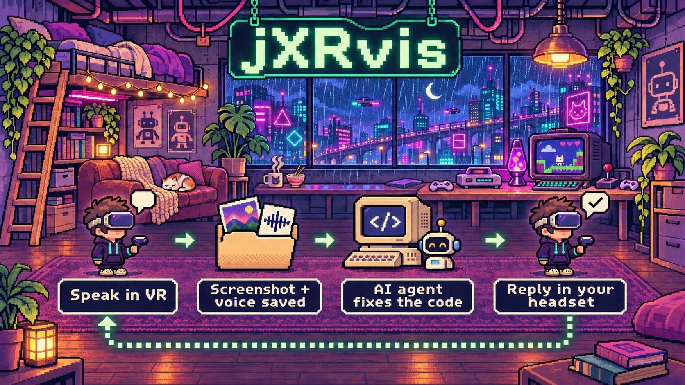
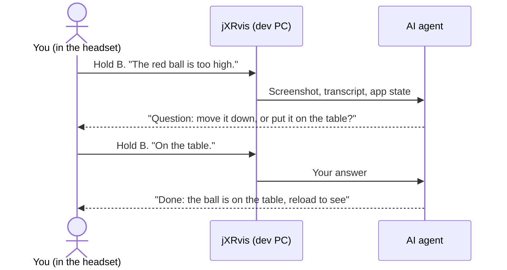

<div align="center">

# jXRvis

### Speak to your AI coding agent from inside the VR headset.

[Guide](docs/guide.md) · [Spec](SPEC.md) · [Example](example/) · [Issues](https://github.com/e-mric/jxrvis/issues)

[](LICENSE) [](package.json) [](docs/guide.md#agent)



</div>

You test your WebXR app in the headset. When you see a problem, you hold the B button and you speak. Your AI agent receives a screenshot, your words and the app state. The agent changes the code. Then it replies in your view and in your ear. You do not remove the headset.

## Features

- 🎙️ **Voice takes.** Hold a button and speak. jXRvis saves your view, your voice and the app state.
- 📸 **More screenshots.** Speak the words "take a screenshot", or push A or X, while you speak.
- 🔊 **Spoken replies.** The agent replies on a label in your view, and the headset speaks the reply.
- 💬 **Answers by voice.** When the agent asks a question, hold the button again and answer.
- 🤖 **Any agent.** An MCP server, a watcher command, or plain files in a folder.
- 🔒 **Local.** The server and the transcriber operate on your PC. jXRvis does not use a cloud service.

## Quick start

Requirements: Node 22.12 or later.

```bash
git clone https://github.com/e-mric/jxrvis.git
```

```bash
cd jxrvis && npm install && npm run example
```

1. Open http://localhost:5173.
2. Hold the F key and speak. If your PC has no microphone, select **Synthetic voice** first.
3. Release the F key. jXRvis saves the take in `example/feedback/inbox/`.
4. In a second terminal, show the take:

   ```bash
   npx jxrvis-watch --inbox example/feedback/inbox --include-existing --once
   ```

5. Reply as the agent. Use the take id from step 4:

   ```bash
   echo "Done: ball moved down, reload to see" >> example/feedback/inbox/<id>/status.txt
   ```

6. Look at the page. The reply shows in 3 seconds or less.

To test on a Quest, type `npm run example:headset`. On the Quest, open `https://<your-pc-ip>:5173`, accept the certificate warning one time, push **Enter VR** and hold B.

## Works with

| Agents | Engines | Servers |
| --- | --- | --- |
| Claude Code, Codex, Cursor, Windsurf, Cline and all MCP clients | three.js (adapter included), Babylon.js, A-Frame, IWSDK and others through the [core client](docs/guide.md#headset-client-other-engines) | Vite, Express, connect, the [standalone server](docs/guide.md#standalone-server) |

## Add jXRvis to your project

1. Install the package:

   ```bash
   npm install --save-dev github:e-mric/jxrvis
   ```

2. Add `feedback/` to your `.gitignore` file. The takes and the fix notes go in this folder.
3. Add the Vite plugin to `vite.config.ts`:

   ```ts
   import {defineConfig} from 'vite';
   import {jxrvis} from 'jxrvis/vite';

   export default defineConfig({
     plugins: [jxrvis({transcribe: 'http://127.0.0.1:8788/transcribe'})],
   });
   ```

4. Attach the headset client to your three.js scene:

   ```ts
   import {Clock} from 'three';
   import {attachFeedback} from 'jxrvis/three';

   const feedback = attachFeedback({renderer, scene, camera, agentName: 'Claude'});
   const clock = new Clock();
   renderer.setAnimationLoop(() => {
     feedback.update(clock.getDelta());
     renderer.render(scene, camera);
   });
   ```

5. Start the local Whisper server, which changes your voice into text. Most agents cannot read a voice file, so this step is necessary in practice. It needs Python and ffmpeg, and an NVIDIA GPU is best. The [guide](docs/guide.md#transcription) gives the install steps.

   ```bash
   .venv/Scripts/python node_modules/jxrvis/tools/whisper-server.py --model turbo
   ```

6. Connect your agent. For Claude Code:

   ```bash
   claude mcp add jxrvis -- npx jxrvis-mcp --inbox feedback/inbox
   ```

   For other agents, see [Agent](docs/guide.md#agent) in the guide.
7. Copy [agents/snippet.md](agents/snippet.md) into the `AGENTS.md` or `CLAUDE.md` file of your project.
8. Tell the agent: **"watch the feedback"**.

## Controls

| In the headset | On the desktop | Result |
| --- | --- | --- |
| Hold B or Y and speak | Hold F | jXRvis takes a screenshot and records your voice until you release the button. |
| Speak "take a screenshot" | Speak "take a screenshot" | One more screenshot, approximately 1 s later. The maximum is 8 for each take. |
| Push A or X while you speak | Push P | One more screenshot, immediately. |
| Hold B again after a question | Hold F | Your answer goes to the agent. |

The headset shows each reply on a label in your view and speaks `Question`, `Done` and `Skipped` replies.

## How it works



jXRvis keeps each take in a folder. The agent reads the folder and writes its replies to `status.txt`:

```
feedback/inbox/2026-11-07_14-03-22/
├── view.png         your view when you started to speak
├── view-2.png …     more screenshots that you asked for
├── voice.webm       your voice
├── transcript.txt   your words as text
├── context.json     the app state, the head position, the console errors
└── status.txt       the replies from the agent, one line for each reply
```

## Troubleshooting

| Problem | Cause and solution |
| --- | --- |
| The browser does not give the microphone | The page must use `https://` or `http://localhost`. With a USB cable, type `adb reverse tcp:5173 tcp:5173` and open `http://localhost:5173` on the Quest. Other methods are in the [guide](docs/guide.md#https-and-the-microphone). |
| The take has no transcript | The Whisper server does not operate, or the `transcribe` URL is wrong. Open `http://127.0.0.1:8788/health`. |
| "Take a screenshot" has no effect | This function needs the Whisper server. Push A or X instead. |
| The label never shows a reply | The agent is not connected, or it watches a different folder. Make sure that `--inbox` is the same folder as in the Vite plugin. |

## Privacy

The takes stay on your PC, and the inbox folder tells git to ignore its contents. jXRvis does not send data to a cloud service. Your AI agent can send the screenshots and transcripts to its model provider, as it does with your code.

## Status

This is version 0.1. It comes from the feedback system of a Quest 3 game. We tested this package on a desktop computer. We did not test this package on a Quest.

## License

[MIT](LICENSE)
