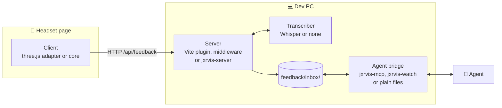
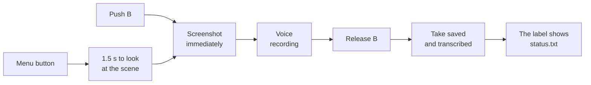
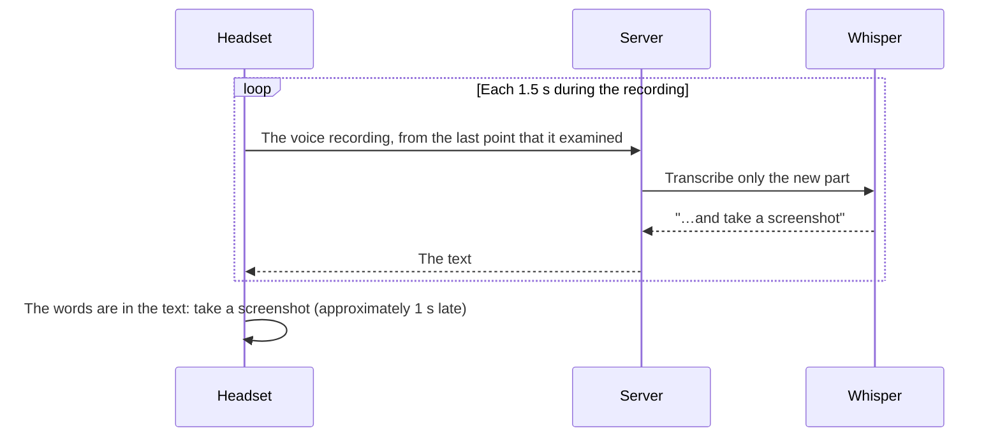
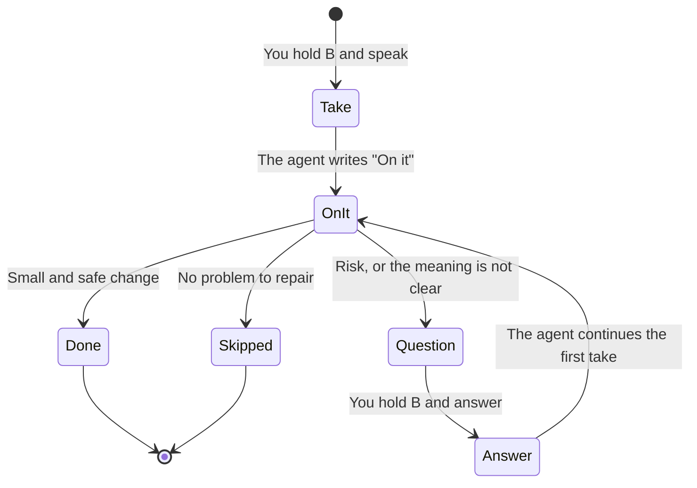
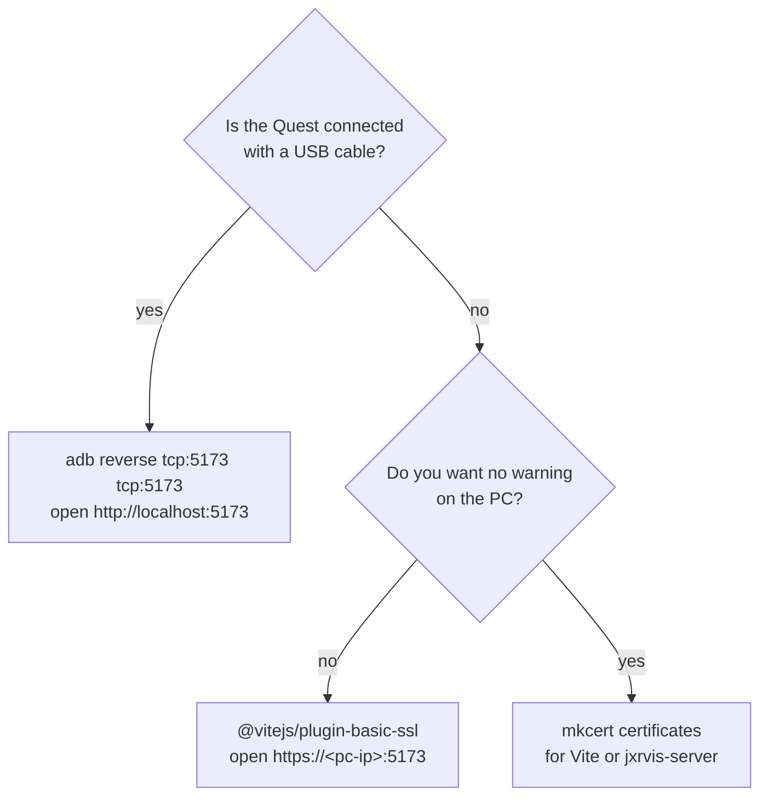

# jXRvis guide

The [README](../README.md) gives the short version. This guide gives all the options. [SPEC.md](../SPEC.md) gives the file format and the HTTP routes.

- [The parts of jXRvis](#the-parts-of-jxrvis)
- [Install](#install)
- [Server](#server)
- [Headset client (three.js)](#headset-client-threejs)
- [More screenshots during a take](#more-screenshots-during-a-take)
- [Voice replies and answers](#voice-replies-and-answers)
- [Headset client (other engines)](#headset-client-other-engines)
- [Agent](#agent)
- [Transcription](#transcription)
- [HTTPS and the microphone](#https-and-the-microphone)
- [Standalone server](#standalone-server)
- [Develop](#develop)
- [Related projects](#related-projects)

## The parts of jXRvis

jXRvis is a set of files in a folder. It is not a framework. You can replace each part in the diagram with your own part. The new part must read and write the same files.



| Part | In this repository | Alternative |
| --- | --- | --- |
| Server | Vite plugin, connect middleware, standalone HTTPS server | A server that has the routes in SPEC.md |
| Transcriber | None (voice only), or the local Whisper server in `tools/` | A `transcribe(audio) → text` function or an HTTP endpoint |
| Headset client | A core for all engines and a three.js adapter | Babylon.js, A-Frame, IWSDK, or a Unity or Unreal client that obeys SPEC.md |
| Agent bridge | `jxrvis-mcp` (MCP on stdio), `jxrvis-watch` (one line for each take), or plain files | An agent that can read a folder and write a text file |

**Privacy.** The screenshots and the voice recordings stay on your dev PC. jXRvis does not use a cloud service. The inbox folder has its own `.gitignore` file, so git does not record the takes.

> **Note:** Your agent can send the takes to its model provider. It does the same with your code.

## Install

1. Install the package from GitHub. The `prepare` script builds the package.

   ```bash
   npm install --save-dev github:e-mric/jxrvis
   ```

2. Recent npm versions can show a warning about the `prepare` script and "allowScripts". The package is already built, so you can ignore this warning. To stop the warning, type `npm install-scripts approve jxrvis`.
3. Add the feedback folder to your `.gitignore` file. The fix notes go in this folder.

   ```gitignore
   feedback/
   ```

To install from a local clone, type `npm install` in the clone. Then type `npm install --save-dev ../jxrvis` in your project.

The three.js adapter uses `three` r160 or later. The other parts do not use a 3D library.

## Server

### Vite

```ts
// vite.config.ts
import {defineConfig} from 'vite';
import {jxrvis} from 'jxrvis/vite';

export default defineConfig({
  plugins: [jxrvis({
    inbox: 'feedback/inbox',                          // default
    transcribe: 'none',                               // or 'http://127.0.0.1:8788/transcribe', or async (audio, {type}) => text
    speech: undefined,                                // optional text-to-speech URL or function (see Voice)
  })],
});
```

The plugin adds the routes to your Vite dev server and to `vite preview`. Thus the routes have the same origin and the same HTTPS as your page. The routes are not in production builds.

### Other Node servers

Express, connect, the `setupMiddlewares` option of webpack-dev-server and `node:http` can use the middleware directly:

```ts
import {feedbackInbox} from 'jxrvis/server';
app.use(feedbackInbox({root: 'feedback/inbox', transcribe: 'none'}));
```

If your dev server does not use Node, use the [standalone server](#standalone-server).

## Headset client (three.js)

```ts
import {attachFeedback} from 'jxrvis/three';

const feedback = attachFeedback({
  renderer, scene, camera,
  agentName: 'Claude',                                  // the label shows "Claude: Done: …"
  context: () => ({summary: `level ${level}; ${menu.open ? 'menu open' : 'playing'}`, level, score}),
  hidden: () => [menu.root],                            // not in the screenshot
  holdButtons: [{hand: 'right', button: 5}, {hand: 'left', button: 5}],  // B and Y (default)
  key: 'f',                                             // desktop key to hold (default); null for none
  shotButtons: [{hand: 'right', button: 4}, {hand: 'left', button: 4}],  // A and X (default)
  shotKey: 'p',                                         // desktop key for one more screenshot (default); null for none
  sound: event => sfx.play(event),                      // 'start' | 'shot' | 'saved' | 'status' | 'error'
  voice: 'auto',                                        // speak the replies; 'off' for no voice
  onMessage: text => console.info(text),                // the same messages, outside XR
});

renderer.setAnimationLoop(() => {
  feedback.update(clock.getDelta());                    // reads the buttons, keeps the label in view
  renderer.render(scene, camera);
});

menuButton.onClick = () => feedback.toggle();           // a "Feedback" button in your menu (also for hands)
```

The watcher shows the `summary` text from `context` next to the transcript. Keep this text short.

### Sequence and times



- When you push B or Y (or F), jXRvis takes the screenshot. It records your voice until you release the button.
- When you use the menu button, jXRvis takes the screenshot after 1.5 s. Thus you have time to look at the scene again.
- jXRvis deletes takes that are shorter than 0.4 s. It stops a recording after 90 s.
- After a take, the label reads `status.txt` each 3 s. It stops after 20 minutes, or after a `Done` or `Skipped` line.

The `timing` option controls all these values.

## More screenshots during a take

jXRvis takes the first screenshot when you start to speak. You can add more screenshots while you speak. The maximum is 8 for each take (`maxShots`).

- **Speak the words "take a screenshot".** These phrases also operate: "take another screenshot", "grab a snapshot", "take a picture".
- **Push A or X** (desktop: **P**). jXRvis takes the screenshot immediately.

The diagram shows how jXRvis finds the spoken words:



> **Note:** A spoken screenshot comes approximately 1 s after you speak the words. Keep the item in your view during this time.

For spoken screenshots, the transcriber must transcribe part of a recording. The Whisper server in `tools/` can do this. On a GPU, it is fast. On a CPU, it can be slow. If it is slow, use the A or X button.

The label shows each screenshot ("● Recording… screenshot 2 taken"). jXRvis saves the screenshots as `view-2.png`, `view-3.png` and more. The `views.json` file gives the time (seconds into the recording) and the cause of each screenshot. Thus the agent can compare each screenshot with your words.

To use a different phrase or a different language, give a regular expression in `shotPhrase`. To use only the buttons, set `shotPhrase` to `null`.

## Voice replies and answers

During a test, you look at the scene. Thus the headset speaks the replies from the agent and also shows them. The headset speaks `Question`, `Done` and `Skipped` lines ("Done. Ball moved down, reload to see"). For an `On it` line, the headset plays only the `status` sound. When you start a recording, the headset stops the voice. Thus the voice of the agent is not in your take.



After a `Question`, the headset also speaks "Hold the talk button to answer". Your next take is then your answer:

1. The label shows "Answering…".
2. jXRvis adds `replyTo` (the take with the question) and `question` to the context of your take.
3. The agent continues the first take.
4. The label continues to show the status of the first take.

The `voice` option sets the source of the voice:

- `'auto'` (default): jXRvis uses the speech route of the server, if the server has one. If not, it uses the text-to-speech of the browser (Web Speech API). This does not use the network.
- `'browser'`, `'server'` or `'off'`.
- A function `text => …`, for example for a character in your game or for spatial audio.

To stop the voice during a session, set `feedback.client.voice = 'off'`. The `voiceLang` option (for example `'en-US'`) sets the language of the browser voice. The `speakPrefixes` option sets the status lines that the headset speaks.

Some headset browsers do not have voices. In this condition, give a voice to the server:

- Vite plugin or middleware: `speech: 'http://127.0.0.1:5002/speak'`.
- Standalone server: `--speech <url>`.
- A function: `speech: async text => ({audio, type: 'audio/wav'})`.

The text-to-speech server must accept `POST {"text": "…"}` and send WAV, MP3, OGG or WebM audio. Piper, Kokoro and Coqui can do this with a small wrapper. The PC makes the audio and the headset plays it. No data goes out of the PC.

## Headset client (other engines)

The core does not use a 3D library. Give it a screenshot function and a function that shows text:

```ts
import {createFeedbackClient, bindKey} from 'jxrvis/client';

const client = createFeedbackClient({
  snapshot: () => ({image: canvas.toDataURL('image/png'), details: {xr: inXR}}),
  context: () => ({summary: 'main menu'}),
  show: (text, seconds) => myLabel.set(text, seconds),
});
bindKey(client, {key: 'f', shotKey: 'p'});
// controller: client.holdDown() when pushed, client.release() when released,
// client.shot() for one more screenshot; menu: client.toggle()
```

For a Unity or Unreal client, write the HTTP calls and the client behavior in [SPEC.md](../SPEC.md). The server and the agent bridge do not change.

## Agent

1. Copy [agents/snippet.md](../agents/snippet.md) into the `AGENTS.md` or `CLAUDE.md` file of your project. Alternatively, install [agents/skills/jxrvis/SKILL.md](../agents/skills/jxrvis/SKILL.md) as a skill.
2. Connect the agent to the inbox. Use one of the three methods below.
3. Tell the agent: "watch the feedback".

The snippet gives these rules to the agent:

- Make small changes immediately.
- Ask before a change that has risk or that is not clear.
- Write status lines of 70 characters or less.
- Write a fix note at the end of the session.

### Method 1: MCP

Use this method for Claude Code, Codex, Cursor, Windsurf, Cline and other MCP clients. The MCP server has these tools:

- `next_feedback`: waits for the next take. It sends the transcript, the context, the file paths and all the screenshots as images.
- `list_feedback` and `get_feedback`: read the takes.
- `set_status(id, text)`: writes a status line.

For Claude Code, type:

```bash
claude mcp add jxrvis -- npx jxrvis-mcp --inbox feedback/inbox
```

For other clients, add this to their MCP configuration:

```json
{"mcpServers": {"jxrvis": {"command": "npx", "args": ["jxrvis-mcp", "--inbox", "feedback/inbox"]}}}
```

### Method 2: watcher

Use this method for agents that can read the output of a command (the Monitor tool of Claude Code, a terminal multiplexer, a script):

```bash
npx jxrvis-watch --inbox feedback/inbox
```

The watcher writes one line for each new take, when the transcript is ready:

```
FEEDBACK <id> [<summary>] (+N screenshots): <transcript>
ANSWER <id> to <asking id> [<question>]: <transcript>
```

### Method 3: plain files

The agent lists `feedback/inbox/`, reads a take and adds a line to its `status.txt` file. No other step is necessary.

## Transcription

If you do not use a transcriber, jXRvis keeps the voice file. The agent then uses the screenshots and the context. To get transcripts, use the local Whisper server ([tools/whisper-server.py](../tools/whisper-server.py)). It uses CUDA if the PC has an NVIDIA GPU. If not, it uses the CPU. No data goes out of the PC.

1. Make a Python environment:

   ```bash
   python -m venv .venv
   ```

2. Install the requirements:

   ```bash
   .venv/Scripts/pip install -r tools/requirements-whisper.txt
   ```

3. Start the server:

   ```bash
   .venv/Scripts/python tools/whisper-server.py --model turbo
   ```

4. In your jXRvis server, set `transcribe: 'http://127.0.0.1:8788/transcribe'`.

> **Note:** On macOS and Linux, use `.venv/bin/…`. Put ffmpeg on the PATH. For a GPU, install the CUDA version of torch before step 2. At the first start, the server downloads the model. The `turbo` model is 1.6 GB.

Server options:

- `--language en`: the server does not try to find the language.
- `--prompt "Words your app uses"`: helps with names and special words.
- `--model small`: a faster model for a CPU.

You can also use a function: `transcribe: async (audio, {type}) => myService(audio, type)`. If there is no transcript, return `null`. If the function fails, jXRvis keeps the voice file.

## HTTPS and the microphone

The browser gives the microphone only to `https://` pages and to `http://localhost`. Use the diagram to select a method:



- **adb reverse** (USB cable, no certificate): set the Quest to developer mode. Type `adb reverse tcp:5173 tcp:5173`. Open `http://localhost:5173` in the Quest browser.
- **Self-signed HTTPS on the local network**: use `@vitejs/plugin-basic-ssl` and `vite --host 0.0.0.0`. The example uses this method. Open `https://<pc-ip>:5173` and accept the warning one time.
- **A trusted local certificate**: type `mkcert -install && mkcert 192.168.1.20 localhost`. This makes certificates that your PC trusts. Give them to the `server.https` option of Vite, or to `--cert/--key` of the standalone server.

> **Note:** The Quest does not trust the mkcert certificates. You must accept the warning one time on the Quest.

## Standalone server

Use the standalone server in these conditions:

- Your project does not use a Node dev server.
- You use a Unity or Unreal client.
- You serve a built app.

```bash
npx jxrvis-server --inbox feedback/inbox --static dist --host 0.0.0.0 --cert pc.pem --key pc-key.pem --transcribe http://127.0.0.1:8788/transcribe
```

Without `--cert/--key`, the server uses HTTP. HTTP is satisfactory on a desktop and with adb reverse.

To use the standalone server with a different dev server, send `/api/feedback` to it through a proxy. Keep the original `Host` header. In the `server.proxy` option of Vite, do not set `changeOrigin`.

> **Caution:** The inbox accepts a request only if its `Origin` agrees with the host. If the proxy changes the `Host` header, the inbox refuses all requests.

## Develop

To run the tests:

```bash
npm test
```

To do all the checks:

```bash
npm run verify
```

The `verify` script checks the types, runs the tests, builds the package and builds the example. Node runs the TypeScript files directly (`--experimental-strip-types`). `npm run build` writes the `dist/` folder.

To test the voice functions without a microphone, open the example with `?synthetic&voiceFile=<url>`. The URL is a recording in the `example/` folder. Each take then plays this file in place of the microphone.

## Related projects

- **IWSDK AI-assisted dev tooling** ([docs](https://developers.meta.com/horizon/documentation/web/iwsdk-ai-assisted-dev-tooling)): an MCP server for Vite. With it, an agent takes screenshots, reads the console, reloads the page and simulates headset input. There, the agent examines the app. With jXRvis, the person in the headset tells the agent about the problem. You can use the two tools together.
- **Meta in-headset playtesting feedback**: sends screenshots and voice from the headset to the Developer Dashboard. Persons read them there. There is no agent and no reply in the headset.
- **talkthrough-mcp**: a local MCP server that changes desktop screen recordings with speech into issue drafts.
- **MCPFeedback, MarkLayer** and similar tools: web screenshots with notes, as bug reports for agents.
